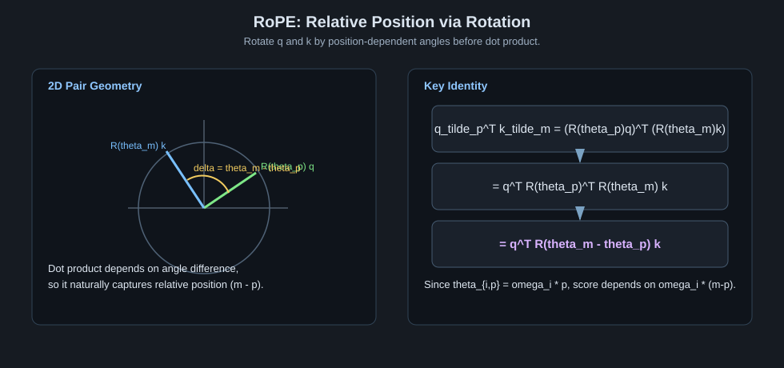

# Rotary Position Embedding (RoPE)

> Part 3 in the sequence: Position Problem -> Sinusoidal Position Encoding -> RoPE.
> Key idea: encode position by rotating query/key vectors, so relative position appears directly inside attention scores.

---

## 1. Motivation from Part 2

Sinusoidal encoding adds $PE(pos)$ to token embeddings:

$$
z_{pos} = x_{pos} + PE(pos)
$$

RoPE instead applies position-dependent rotation to query and key vectors before dot product.

This puts position into the attention geometry itself.

### 1.1 Why Rotation?

We want attention to reflect **relative distance** (for example, tokens 2 apart) rather than only absolute indices.

Rotation gives exactly this behavior. If query and key are rotated by position-dependent angles, their dot product depends on the **angle difference**, so absolute positions cancel and relative offset remains.

For vectors $q, k$ at positions $m, n$ with base angle $\theta$:

$$
\bigl(R(m\theta)q\bigr)^\top\bigl(R(n\theta)k\bigr)
= q^\top R\bigl((n-m)\theta\bigr)k
$$

This is the core reason RoPE works: position is encoded as rotation, and standard attention recovers relative position through the geometry of dot products, without changing the attention formula.

Intuition (clock-hand analogy): two clock hands each have an absolute angle, but what often matters is the angle **between** them. RoPE uses the same idea: each token gets an absolute rotation, while the query-key interaction naturally depends on the relative angular difference.

This intuition follows the same argument presented in Michael Brenndoerfer's RoPE write-up:
https://mbrenndoerfer.com/writing/rotary-position-embedding-rope-transformers

---

## 2. RoPE Definition

Split each head vector into 2D pairs. For one pair with angle $\theta$, define:

$$
R(\theta)=
\begin{bmatrix}
\cos\theta & -\sin\theta \\
\sin\theta & \cos\theta
\end{bmatrix}
$$

For frequency $\omega_i$ and position $p$, angle is $\theta_{i,p}=\omega_i p$.

Then for each pair $i$:

$$
\widetilde{q}_{p,i} = R(\theta_{i,p}) q_{p,i},
\qquad
\widetilde{k}_{m,i} = R(\theta_{i,m}) k_{m,i}
$$

Concatenate all rotated pairs to form $\widetilde{q}_p, \widetilde{k}_m$.

Attention score uses rotated vectors:

$$
s_{p,m} = \widetilde{q}_p^\top \widetilde{k}_m
$$

---

## 3. The Complete RoPE Formula

The 2D version above is the building block. For a full head vector of even dimension $d$, RoPE rotates every adjacent pair.

Let

$$
q_p = [q_{p,0}, q_{p,1}, \dots, q_{p,d-1}]^\top,
\qquad
k_m = [k_{m,0}, k_{m,1}, \dots, k_{m,d-1}]^\top
$$

For each pair index $i = 0, 1, \dots, \frac{d}{2}-1$, define $\theta_{i,p} = \omega_i p$ and

$$
R_i(p) =
\begin{bmatrix}
\cos(\theta_{i,p}) & -\sin(\theta_{i,p}) \\
\sin(\theta_{i,p}) & \cos(\theta_{i,p})
\end{bmatrix}
$$

Then the full rotated query and key vectors are:

$$
\widetilde{q}_p = \operatorname{RoPE}(q_p, p)=
\bigl[R_0(p)q_{p,0:1},\; R_1(p)q_{p,2:3},\; \dots,\; R_{\frac{d}{2}-1}(p)q_{p,d-2:d-1}\bigr]^\top
$$

$$
\widetilde{k}_m = \operatorname{RoPE}(k_m, m)=
\bigl[R_0(m)k_{m,0:1},\; R_1(m)k_{m,2:3},\; \dots,\; R_{\frac{d}{2}-1}(m)k_{m,d-2:d-1}\bigr]^\top
$$

Equivalently, using a block-diagonal rotation matrix,

$$
\widetilde{q}_p = \mathcal{R}(p) q_p,
\qquad
\widetilde{k}_m = \mathcal{R}(m) k_m
$$

where

$$
\mathcal{R}(p) = \operatorname{diag}\bigl(R_0(p), R_1(p), \dots, R_{\frac{d}{2}-1}(p)\bigr)
$$

This is the complete RoPE formula used in practice: every 2D subspace gets its own frequency, and the full attention score is computed from the rotated whole vectors.

---

## 4. Core Proof: Relative Position Emerges Naturally

For one 2D pair:

$$
\widetilde{q}_p^\top \widetilde{k}_m=
\left(R(\theta_p)q\right)^\top\left(R(\theta_m)k\right)
$$

$$
= q^\top R(\theta_p)^\top R(\theta_m)k
$$

Since $R(\theta)^\top = R(-\theta)$ and rotations compose additively:

$$
R(\theta_p)^\top R(\theta_m) = R(-\theta_p)R(\theta_m) = R(\theta_m-\theta_p)
$$

Therefore:

$$
\widetilde{q}_p^\top \widetilde{k}_m = q^\top R(\theta_m-\theta_p)k
$$

Because $\theta_{i,p}=\omega_i p$, we get dependence on $(m-p)$ for each frequency:

$$
\omega_i m - \omega_i p = \omega_i(m-p)
$$

So RoPE makes score contributions explicitly relative-position aware.

---

## 5. Why This Helps in Practice

- Relative distance is encoded directly in $QK^\top$.
- Works well with long contexts in many LLMs.
- No learned absolute position table is required.
- Compatible with multi-head attention and common Transformer implementations.

---

## 6. Minimal Attention Pipeline with RoPE

1. Compute $Q,K,V$ from token states.
2. Apply RoPE to $Q,K$ only (not $V$).
3. Compute attention weights with rotated $Q,K$:

$$
A = \text{softmax}\!\left(\frac{\tilde{Q}\tilde{K}^\top}{\sqrt{d_k}}\right)
$$

4. Output:

$$
\text{Attn} = AV
$$

---

## 7. Relation to Previous Two Articles

Progression recap:

1. **Position Problem**: no positional signal => permutation-equivariant attention.
2. **Sinusoidal**: inject absolute position additively into embeddings.
3. **RoPE**: inject position multiplicatively via rotation in query/key space so relative offsets affect similarity directly.

---

## 8. Visual Intuition



---

## 9. One-Sentence Summary

RoPE encodes position by rotating query/key vector pairs, yielding attention scores that naturally depend on relative token distance.

## Efficient Implementation

Modern deep learning frameworks excel at vectorized operations, so we want to apply RoPE to all tokens in a sequence simultaneously.

The key insight is that we can precompute all rotation angles as a matrix and apply them through broadcasting. Instead of looping over positions and dimension pairs, we compute everything in parallel. The rotation angles form an outer product: positions multiplied by frequencies gives a matrix of shape (seq_len, d/2) where entry [m, i] is the rotation angle for position m and dimension pair i. Computing cos and sin of this matrix gives two tensors of the same shape, and the rotation of all tokens can then be expressed as a single vectorized multiply-and-add.

```python
def apply_rope_batch(x, frequencies):
    """Apply RoPE to a batch of vectors at consecutive positions.

    Args:
        x: Input tensor of shape (seq_len, d)
        frequencies: Pre-computed frequencies of shape (d/2,)

    Returns:
        Rotated tensor of shape (seq_len, d)
    """
    seq_len, d = x.shape
    positions = np.arange(seq_len)

    # Compute all rotation angles: (seq_len, d/2)
    angles = np.outer(positions, frequencies)

    # Compute cos and sin for all positions and frequencies
    cos_angles = np.cos(angles)
    sin_angles = np.sin(angles)

    # Reshape input to pairs: (seq_len, d/2, 2)
    x_pairs = x.reshape(seq_len, -1, 2)

    # Apply rotation to each pair
    # x_new[0] = x[0] * cos - x[1] * sin
    # x_new[1] = x[0] * sin + x[1] * cos
    x_rotated = np.stack(
        [
            x_pairs[:, :, 0] * cos_angles - x_pairs[:, :, 1] * sin_angles,
            x_pairs[:, :, 0] * sin_angles + x_pairs[:, :, 1] * cos_angles,
        ],
        axis=-1,
    )

    return x_rotated.reshape(seq_len, d)
```

## Integration with Self-Attention

With efficient RoPE implementation in hand, let's see how it fits into a complete self-attention layer. The integration is remarkably clean: RoPE slots in between the QKV projections and the attention computation, requiring no architectural changes to the transformer.

Here's the complete flow:

1. Project input embeddings to Q, K, V using learned weight matrices
2. Apply RoPE to Q and K (but not to V)
3. Compute scaled dot-product attention as usual
4. Return the attention output

The critical detail is step 2: we rotate queries and keys but leave values untouched. Let's implement this:

```python
class RoPEAttention:
    """Self-attention with Rotary Position Embedding."""

    def __init__(self, d_model, d_k, base=10000, seed=None):
        """Initialize RoPE attention layer.

        Args:
            d_model: Input embedding dimension
            d_k: Query/Key/Value dimension (must be even for RoPE)
            base: Base for frequency computation
            seed: Random seed for weight initialization
        """
        if d_k % 2 != 0:
            raise ValueError("d_k must be even for RoPE")

        if seed is not None:
            np.random.seed(seed)

        # Projection matrices
        scale = np.sqrt(2.0 / (d_model + d_k))
        self.W_q = np.random.randn(d_model, d_k) * scale
        self.W_k = np.random.randn(d_model, d_k) * scale
        self.W_v = np.random.randn(d_model, d_k) * scale

        # RoPE frequencies
        self.frequencies = compute_rope_frequencies(d_k, base)
        self.d_k = d_k

    def forward(self, x):
        """Compute RoPE attention.

        Args:
            x: Input embeddings of shape (seq_len, d_model)

        Returns:
            output: Attention output of shape (seq_len, d_k)
            attention_weights: Weights of shape (seq_len, seq_len)
        """
        # Project to Q, K, V
        Q = x @ self.W_q
        K = x @ self.W_k
        V = x @ self.W_v

        # Apply RoPE to Q and K
        Q_rope = apply_rope_batch(Q, self.frequencies)
        K_rope = apply_rope_batch(K, self.frequencies)

        # Scaled dot-product attention
        scores = Q_rope @ K_rope.T / np.sqrt(self.d_k)

        # Softmax
        scores_stable = scores - scores.max(axis=1, keepdims=True)
        attention_weights = np.exp(scores_stable) / np.exp(scores_stable).sum(
            axis=1, keepdims=True
        )

        # Aggregate values (V is NOT rotated)
        output = attention_weights @ V

        return output, attention_weights
```

Note that **RoPE is applied only to queries and keys, not to values**. This is because:

1. **Queries and keys determine attention patterns**: The dot product between them computes compatibility. RoPE makes this compatibility position-aware.
2. **Values carry content**: They should not be position-encoded because the content itself doesn't depend on position, only how much weight it receives.

Fully understand the NOTE Reference [RoPE-QA5](./RoPE-QA5.md)
