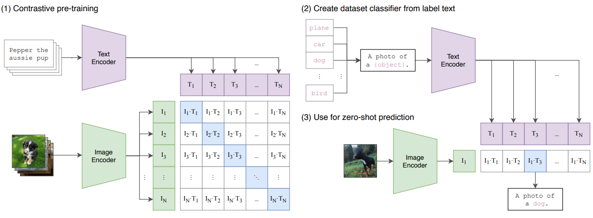
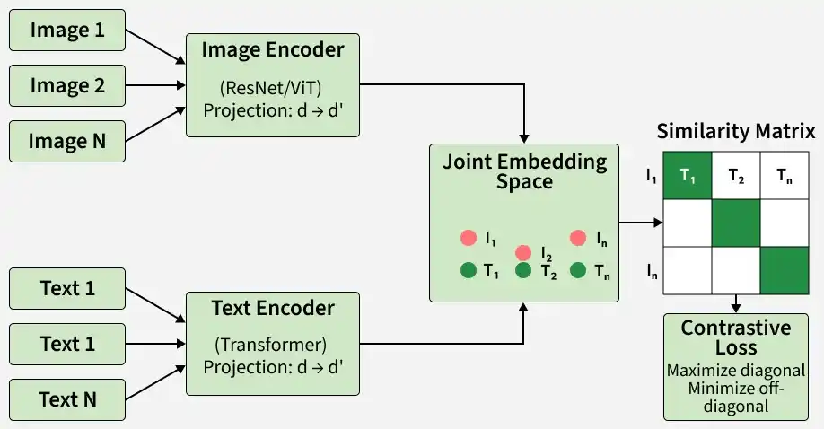

# Contrastive Language-Image Pretraining (CLIP)

## Table of Contents

1. [Overview](#Overview)
2. [Key Features](#KeyFeatures)
3. [Architecture](#Architecture)
4. [Working](#working)
5. [Advantages](#Advantage)
6. [Limitations](#Limitations)

## Overview

CLIP (Contrastive Language-Image Pretraining) is a multimodal AI model that learns the relationship between images and text. By training on image–text pairs, it can understand visual content through natural language descriptions and perform image recognition without task-specific training.

- Uses contrastive learning to distinguish matching and non-matching image–text pairs.
- Combines an image encoder and a text encoder to process visual and textual inputs.
- Enables zero-shot image classification using natural language prompts.

## Key Features

- Multimodal Training: Learns from image–text pairs to build a shared understanding of visual and textual information.
- Zero-Shot Learning: Classifies images into new categories without additional training or fine-tuning.
- Self-Supervised Learning: Learns by distinguishing matching and non-matching image–text pairs instead of relying on manually labeled datasets.

## Architecure

Summary of our approach. While standard image models jointly train an image feature extractor and a linear classifier to predict some label, CLIP jointly trains an image encoder and a text encoder to predict the correct pairings of a batch of (image, text) training examples. At test time the learned text encoder synthesizes a zero-shot linear classifier by embedding the names or descriptions of the target dataset’s classes.

## Working

### 1. Text Encoder

CLIP uses a Transformer-based text encoder to convert text into dense embeddings that capture semantic meaning. The encoder contains 63 million parameters, 12 layers, and 8 attention heads.

### 2. Image Encoder

CLIP uses an image encoder to convert images into feature embeddings. It experimented with both ResNet and Vision Transformers (ViT), with ViT showing superior performance in image understanding.

### 3. Dataset

CLIP was trained on about 400 million image–text pairs collected from the web. The dataset, called WebImageText (WIT), covers around 500,000 words by focusing on terms frequently appearing in English Wikipedia, enabling strong generalization across diverse concepts.

### 4. Training Objective

CLIP learns to align image and text embeddings so that matching pairs are similar and non-matching pairs are far apart in a shared space.

- **Cosine Similarity**: Maximizes similarity for correct pairs and reduces it for incorrect ones.
- **Shared Projection Space**: Maps image and text embeddings into the same dimensional space for comparison.
- **Contrastive Learning**: Trains the model to distinguish between matching and non-matching image–text pairs.
- **Loss Function**: Uses cross-entropy loss to strengthen correct matches and suppress incorrect ones.
- **Inference**: Computes similarity scores between image and text embeddings to find the best match.

## Advantages

- **Image Generation**: Used in models like DALL·E 3 and MidJourney to align text prompts with image embeddings for better text-to-image generation.
- **Image Segmentation**: Helps models like SAM interpret prompts and improve region-based image understanding.
- **Content Moderation**: Detects harmful or inappropriate content by matching images with textual descriptions of policy violations.
- **Semantic Search**: Enables accurate text-to-image and image-to-text retrieval using shared embeddings.
- **Visual Question Answering (VQA)**: Answers questions about images by - linking visual features with natural language queries.

## Limitations

- **Bias in Training Data**: Can inherit biases from web-sourced image–text pairs, leading to unfair or skewed associations.
- **Limited Complex Reasoning**: Struggles with fine-grained visual understanding and deep contextual reasoning.
- **Data Dependency**: Performance depends heavily on the quality and diversity of training data.
- **High Computational Cost**: Requires significant resources for training and deployment, limiting accessibility.
