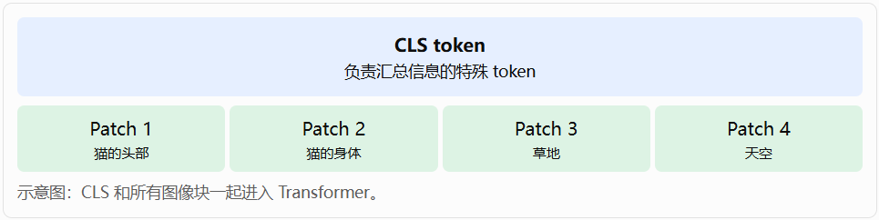
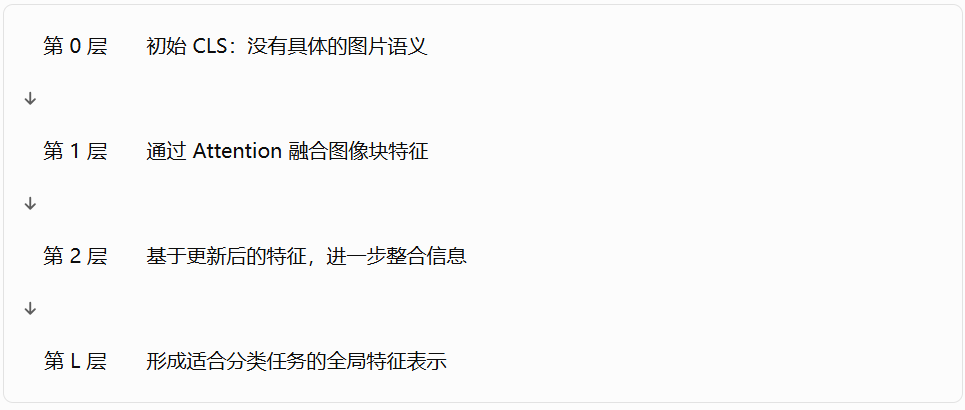
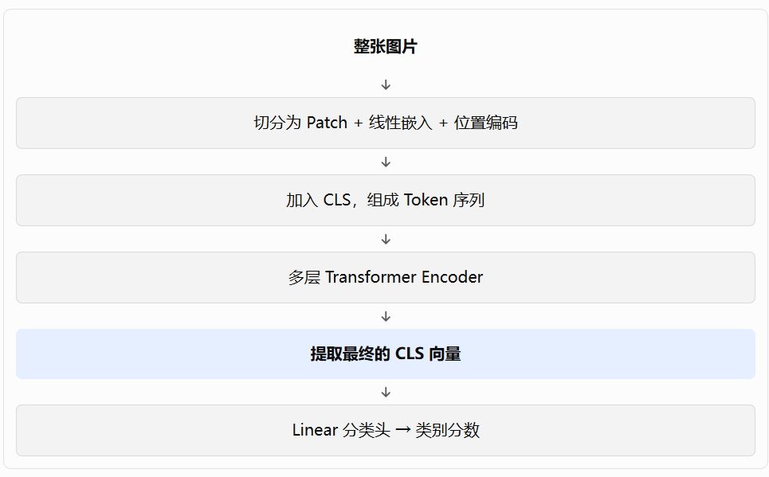

# Qustion about ViT 'class token'

message time: 2026-10-13 11:25:38

ViT模型中放在首位的class token就可以做image分类，这个如何理解？这个做法和CNN的image分类方法完全不一样。

---

## chatgpt response

你的疑问非常关键：**ViT（Vision Transformer）为什么只需要在序列最前面放一个特殊的 `class token`，经过 Transformer 之后，就能用它来判断整张图片属于什么类别？**

而 CNN 的经典做法却是通过卷积层提取特征，再经过池化、全连接层，最终得到分类结果。

这里真正值得理解的，不是 `class token` 放在第一个位置有什么特殊魔力，而是：

**ViT 利用 Self-Attention，让这个特殊 token 在多层计算中逐步聚合整张图片的信息，最后把它变成一份用于图像分类的全局特征表示。**

我们从模型的数据流、数学公式，以及它与 CNN 的区别三个方面来理解。

### 一、先看 ViT 如何处理一张图片

<image src="image.png" alt="Vision Transformer ViT architecture image patches class token transformer encoder classification diagram" aspectRatio="16:9" width="100%"/>

假设输入图片大小为 $224\times224\times3$，ViT 将图片切分为 $16\times16$ 的小块（patch）。

那么每个方向有：

$$
224/16=14
$$

因此总共有：

$$
N=14\times14=196
$$

个图像块。

每个图像块经过线性映射，变成一个向量，再加上位置编码。接下来，在这 196 个图像块 token 前面添加一个可学习的特殊向量 `class token`。

最终输入 Transformer 的序列是：

$$
X_0=
\begin{bmatrix}
x_{\mathrm{cls}}\\
x_1\\
x_2\\
\vdots\\
x_{196}
\end{bmatrix}
\in\mathbb R^{197\times D}
$$

其中：

- $x_{\mathrm{cls}}$：可学习的分类 token。
- $x_1,\ldots,x_{196}$：196 个图像块的特征向量。
- $D$：每个 token 的特征维度，例如 768。

注意一个重要细节：**刚刚添加的 class token 并不知道图片里有什么。** 它一开始只是一个通过训练学出来的向量，并不天然包含猫、狗、汽车等语义。

那么，它是怎样获得整张图片的信息的？

答案就在 Self-Attention 中。

### 二、核心机制：class token 如何从其他 token 获取信息？

我们先简化到只有 4 个图像块的情况，方便理解。

假设输入序列是：

这里要纠正一个容易产生的误解：class token 并不是在最后才读取其他 token，而是从 Transformer 的第一层开始，就参与 Self-Attention。

#### 1. 计算 class token 对所有 token 的注意力

Self-Attention 的公式是：

$$
Q=XW_Q,\quad K=XW_K,\quad V=XW_V
$$

$$
\operatorname{Attention}(X)
=\operatorname{softmax}
\left(\frac{QK^\top}{\sqrt{d_k}}\right)V
$$

我们只关注输出矩阵中对应 class token 的那一行。

设 class token 的 Query 为 $q_{\mathrm{cls}}$，所有 token 的 Key 和 Value 分别为 $k_j,v_j$，那么：

$$
z_{\mathrm{cls}}'
=
\sum_{j=0}^{N}
\alpha_{\mathrm{cls},j}v_j
$$

其中：

$$
\alpha_{\mathrm{cls},j}
=
\frac{
\exp(q_{\mathrm{cls}}^\top k_j/\sqrt{d_k})
}{
\sum_{m=0}^{N}
\exp(q_{\mathrm{cls}}^\top k_m/\sqrt{d_k})
}
$$

这就是理解 class token 的关键公式。

它表示：

- $q_{\mathrm{cls}}$：class token 当前想关注什么信息。
- $k_j$：每个 token 提供用于匹配的特征。
- $v_j$：每个 token 实际提供的信息内容。
- $\alpha_{\mathrm{cls},j}$：class token 对第 $j$ 个 token 分配的注意力权重。

举个纯粹用于说明机制的假设例子：

| Token | 注意力权重 |
|---|---:|
| CLS 自身 | 0.05 |
| 猫的头部 | 0.35 |
| 猫的身体 | 0.40 |
| 草地 | 0.10 |
| 天空 | 0.10 |

这些数值不是实际模型的固定值，只是为了说明计算过程。

那么 class token 的新表示就是这些 Value 的加权和：

$$
z_{\mathrm{cls}}'
=
0.05v_{\mathrm{cls}}
+0.35v_{\mathrm{head}}
+0.40v_{\mathrm{body}}
+0.10v_{\mathrm{grass}}
+0.10v_{\mathrm{sky}}
$$

它由此获得了来自整张图片不同区域的信息。

实际 ViT 使用多头注意力，各个头可以学习不同的信息关系，并且后面还有残差连接、LayerNorm 和 MLP 等计算。

**所以，class token 的特殊之处不是它天然知道整张图片的内容，而是它作为一个可学习的查询向量，能够通过 Attention 从其他 token 中获取信息。**

#### 2. 为什么经过多层 Transformer 后，它能代表整张图片？

第一层之后，class token 已经可以融合图像块的信息。

第二层时，它又会基于更新后的 token 表示重新计算 Attention。

第三层、第四层也是如此。

可以把过程理解成：

这里还有一个更深的细节。

CLS 不仅能直接读取各个图像块，还能通过多层 Attention 获取经过其他图像块加工的信息。例如，某个图像块在第一层已经结合了其他区域的特征，那么 CLS 在后续层读取它时，就可能获得这些关联信息。

因此，CLS 最终并不只是简单地把所有图像块平均起来，而是可以形成一种经过多层非线性计算的全局表示。

不过要注意：它并不保证完整保留图片里的所有信息。模型只需要学到对目标任务有用的特征。

---

### 三、拿到 class token 后，如何完成分类？

经过 $L$ 层 Transformer 后，输出仍然是一个序列：

$$
X_L\in\mathbb R^{(N+1)\times D}
$$

ViT 取出第一个位置的向量：

$$
h_{\mathrm{cls}}=X_L[0]
$$

然后通过一个分类头，例如线性层：

$$
\operatorname{logits}
=
W_{\mathrm{head}}h_{\mathrm{cls}}+b
$$

假设任务是识别猫、狗、汽车，分类头就输出三个分数：

$$
\operatorname{logits}
=
\begin{bmatrix}
2.8 & 0.6 & -1.2
\end{bmatrix}
$$

经过 Softmax 后，可以得到对应的类别概率；分数最高的类别是猫。

这些数字同样只是示例。

整个流程可以概括为：

### 四、最重要的问题：模型怎么知道 CLS 应该收集哪些信息？

这是整个机制里容易被忽略的部分。

答案是：**通过分类任务的损失函数和反向传播学习出来。**

假设训练图片是一只猫，真实标签是 `cat`。

模型计算：

$$
\hat y=f_\theta(X_0)
$$

然后计算交叉熵损失：

$$
\mathcal L=-\log P_\theta(y=\text{cat}\mid X_0)
$$

如果预测错了，损失就会推动模型参数调整。

梯度会通过分类头传回最终的 CLS 向量，再经过 Transformer 的各层，影响：

- Attention 的 $W_Q,W_K,W_V$ 参数；
- 各层 MLP 参数；
- CLS 的初始可学习向量；
- 其他参与计算的模型参数。

经过大量训练样本后，模型会逐渐学到：为了让分类正确，CLS 应当通过 Attention 获取哪些特征、关注哪些区域，以及怎样组合这些信息。

这并不意味着模型一定会形成类似人类的“先找猫头、再找猫身体”的明确策略。具体学到什么取决于数据、架构和训练过程。

### 五、这与 CNN 的图像分类有什么本质区别？

你的判断有一部分是正确的：两者的特征提取机制确实不同。

    <image src="image-4.png"/>
    
<strong>CNN</strong>卷积核在局部区域提取特征，通过层级结构扩大感受野，再经全局池化或全连接层完成分类。

    <image src="image-5.png"/>
    
<strong>ViT</strong>将图像块表示为 Token，通过 Self-Attention 建立不同 Token 之间的关系，并用 CLS 汇总用于分类的信息。

具体对比如下：

| 比较维度 | CNN | ViT |
|---|---|---|
| 输入表示 | 像素组成的空间特征图 | 图像块组成的 Token 序列 |
| 基本特征提取 | 卷积操作 | Self-Attention 与 MLP |
| 位置关系 | 卷积结构天然利用局部邻域 | 通常加入位置编码 |
| 全局信息获取 | 通过多层卷积扩大感受野、池化等 | 通过各层 Attention 交换信息 |
| 分类输入 | 常见为全局池化后的特征 | 常见为最终 CLS 向量 |
| 分类头 | 全连接层等 | 全连接层等 |

但需要特别指出：**CNN 也不是一定要把整张图片的特征逐层压缩成一个固定向量，ViT 也不是一定要用 CLS 才能分类。**

例如：

- CNN 可以使用 Global Average Pooling，将每个通道的空间特征取平均，再进行分类。
- ViT 可以对所有最终 Patch Token 做平均池化，再进行分类，不使用 CLS。
- 两种模型都可以在特征提取网络后面接一个线性分类头。

所以，两者真正不同的是特征提取和信息交互机制，而不是最后分类的形式。

### 六、CLS token 是不是一定要放在序列第一个位置？

不是。

在标准 ViT 中，CLS 通常放在序列最前面，这是模型的设计约定，便于取出 `X[:, 0]` 作为分类表示。

只要模型训练时的位置编码、序列组织方式和读取方式保持一致，CLS 并没有必须处于第一位的数学要求。

它也不是 Transformer 内置的一种特殊运算。对于 Transformer 来说，它就是一个特殊用途的可学习向量，与其他 Token 一起参与计算。

它之所以具有分类意义，是因为训练目标要求模型利用它来完成分类。

另外，CLS token 的思想并非 ViT 独有。例如，BERT 在文本分类中也可以使用首位的 `[CLS]` 向量作为整个文本的表示。

---

### 七、用一句话建立正确的直觉

可以把 ViT 的 CLS token 理解为一个**专门为分类任务设置的、可学习的全局信息汇总接口**。

它不是直接读取图片，也不是一开始就拥有图片语义，而是：

1. 与所有 Patch Token 一起进入 Transformer。
2. 通过多层 Self-Attention，不断从其他 Token 中获取和整合信息。
3. 在分类损失的监督下，学会形成对目标类别有用的表示。
4. 最后将这个表示交给分类头，输出类别分数。

如果你正在自己实现 ViT，可以做一个很有价值的实验：同时训练两个结构基本相同的模型，一个使用 CLS token，另一个对最终的 Patch Token 做平均池化。对比它们的训练损失、验证准确率和收敛速度，就能更直观地理解：**CLS 是一种全局特征聚合设计，而不是图像分类的必要条件。**
